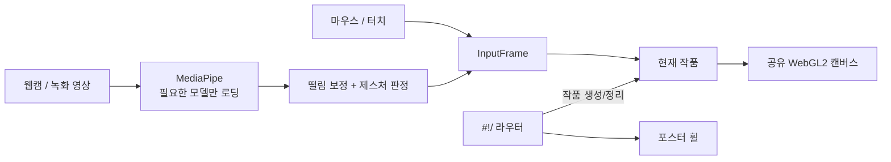

# PRD: 가칭 「MOVE」, 몸으로 체험하는 WebGL 시각 작품 모음집

> 초안 v0.1 · 2026-10-23 · 팀 3인 · 바이브코딩으로 개발

## 1. 한 줄 정의

웹캠 앞에서 몸, 손, 얼굴을 움직이면 반응하는 WebGL 시각 작품을 모은 정적 웹사이트. 설치 없이 링크 하나로 체험할 수 있다.

## 2. 레퍼런스: FFF (Form Follows Function)

<https://fff.cmiscm.com/#!/main>. Jongmin Kim이 2013~2018년에 만든 작품으로, Chrome Experiment로 선정됐고 Red Dot 2014를 받았다. 아래 내용은 사이트 설명 문구를 기준으로 정리했다.

| 그대로 가져올 것 | 다르게 할 것 |
|---|---|
| 회전하는 내비게이션 휠과 작품별 포스터 | 입력이 마우스와 터치 → **몸 동작(MediaPipe)**. 마우스와 터치는 대체 입력으로만 사용 |
| 포스터를 누르면 작품이 열리는 구조 | 내비게이션도 손으로 조작 가능 (휠 돌리기, 머물러서 선택하기) |
| 작품마다 고유한 디자인과 상호작용. 같은 틀에 끼워 맞춘 템플릿이 아님 | |
| 데스크톱과 태블릿에서 모두 동작 | 태블릿은 v1에서 최선 노력 수준 (§12 참고) |
| | 디자인, 코드, 에셋은 모두 직접 제작. FFF 복제 금지 |

## 3. 목표와 비목표

**목표**

- G1. 카메라를 허락하고 3초 안에 "내 몸이 화면을 바꾼다"는 반응을 느끼게 한다.
- G2. 첫 공개 때 작품 7개 (P0 3개 + P1 4개).
- G3. 서버 없이 정적 호스팅만으로 운영하고, 영상은 기기 밖으로 나가지 않는다.
- G4. 카메라 없이도 마우스와 터치로 모든 작품을 체험할 수 있다.

**비목표 (v1)**

- 게임 요소 (점수, 승패, 랭킹)
- 계정, 서버, 업로드, 분석 도구
- 영상 녹화와 저장 (v2 후보)
- 스마트폰 최적화, 네이티브 앱

## 4. 사용자와 시나리오

| 사용자 | 환경 | 시나리오 |
|---|---|---|
| 링크를 받은 친구 | 노트북 + 내장 웹캠, 의자에 앉은 상태 | 메인 휠 → 포스터 선택 → 카메라 허락 → 손을 흔들며 체험 → 뒤로 가서 다른 작품 |
| 카메라를 거절한 사람 | 아무 기기 | 같은 흐름을 마우스와 터치로 체험 |
| 전시나 발표 | 큰 화면 + 외장 웹캠, 서 있는 상태 | 손 커서만으로 휠 조작, 선택, 뒤로 가기까지 모두 해결 |

## 5. 경험 원칙

1. **3초 안에 반응:** 설명을 읽기 전에 움직이기만 해도 무언가 일어나야 한다.
2. **설명 대신 힌트:** 작품마다 문장 한 줄과 동작 아이콘 하나만 보여준다.
3. **인식이 실패해도 예쁘게:** 사람을 놓쳐도 화면이 멈추지 않고 기본 애니메이션이 계속 돌아간다.
4. **겉 틀은 공통, 작품은 제각각:** 공통 셸(뒤로 가기, 힌트, 권한 처리)은 통일하고 작품 내부는 자유롭게 만든다.

## 6. 기능 요구사항

### 6.1 메인: 포스터 휠

| ID | 요구사항 | 우선순위 |
|---|---|---|
| MAIN-1 | 작품 포스터가 원형 휠로 배치되고 회전한다 | P0 |
| MAIN-2 | 마우스 드래그, 휠 스크롤, 터치 스와이프, 키보드 화살표로 회전한다 | P0 |
| MAIN-3 | 클릭, 탭, Enter로 작품에 진입한다. 전환 애니메이션 포함 | P0 |
| MAIN-4 | 카메라 모드: 손을 좌우로 휘두르면 휠이 회전하고, 손 커서를 포스터 위에 1.5초 머무르게 하거나 집기 동작을 하면 진입한다 | P1 |
| MAIN-5 | 포스터는 정지 이미지와 짧은 반복 영상(webm/webp)으로 미리보기. 메인 화면에서 실시간 셰이더는 돌리지 않는다 | P0 |
| MAIN-6 | 메인 화면에 "카메라로 조작하기" 버튼을 둔다. 카메라는 사용자가 선택할 때만 켠다 | P1 |

### 6.2 공통 셸 (모든 작품에 적용)

| ID | 요구사항 | 우선순위 |
|---|---|---|
| SHELL-1 | 카메라 권한을 요청하기 전에 안내 화면을 보여준다: "영상은 이 기기 안에서만 처리되며 저장하거나 전송하지 않습니다" | P0 |
| SHELL-2 | 권한을 거절하거나 카메라가 없으면 자동으로 마우스/터치 모드로 전환하고 안내 문구를 표시한다 | P0 |
| SHELL-3 | 카메라 스트림은 작품을 옮겨 다녀도 유지해서 권한을 다시 묻지 않는다. 사용자가 끄면 즉시 중지한다 | P0 |
| SHELL-4 | 뒤로 가기: 화면 버튼, Esc 키, 브라우저 뒤로 가기, 손 커서를 버튼 위에 머무르기 | P0 |
| SHELL-5 | 작품 힌트(문장 한 줄 + 동작 아이콘)를 처음 5초 동안 보여주고, 인식이 끊기면 다시 표시한다 | P0 |
| SHELL-6 | 탭이 숨겨지면 인식과 렌더링을 멈추고, 돌아오면 다시 시작한다 | P0 |
| SHELL-7 | URL 형식은 `#!/main`, `#!/exp/<id>`. 서버 설정 없이 바로 링크를 공유할 수 있다 | P0 |
| SHELL-8 | 디버그 오버레이(`?debug`): 관절 표시, 마스크, fps, 인식 지연 시간 | P0 |
| SHELL-9 | WebGL2를 지원하지 않는 브라우저에서는 안내 화면을 표시한다 | P0 |

### 6.3 입력 계층

| ID | 요구사항 | 우선순위 |
|---|---|---|
| IN-1 | MediaPipe는 앱 전체에서 한 번만 초기화한다. 작품마다 따로 만들지 않는다 | P0 |
| IN-2 | 작품이 선언한 `needs`에 해당하는 모델만 필요할 때 로딩한다 (세그멘테이션, 손, 포즈, 얼굴) | P0 |
| IN-3 | 좌표 규약: 좌우 반전(거울 모드), 화면 기준 0..1 정규화, 원점은 왼쪽 위 | P0 |
| IN-4 | 관절 좌표에 One Euro 필터로 떨림을 보정한다. 작품마다 세기를 조절할 수 있다 | P0 |
| IN-5 | 마우스와 터치를 가짜 손(`Hand`)으로 바꿔서 같은 인터페이스로 전달한다 | P0 |
| IN-6 | 녹화 영상 입력: `?src=fixture:<name>`이면 웹캠 대신 미리 녹화한 영상을 반복 재생한다 | P0 |
| IN-7 | 인식과 렌더링을 분리한다. 렌더링은 60fps로 돌리고 그 사이 프레임의 인식 결과는 보간한다 | P1 |

### 6.4 제스처 어휘 (공통)

모든 작품에서 같은 동작이 같은 의미를 갖도록 입력 계층에서 판정해 제공한다.

| 제스처 | 판정 방법 | 기본 의미 |
|---|---|---|
| 손바닥 펴기 | 다섯 손가락이 모두 펴짐 | 힘을 방출, 밀어내기 |
| 주먹 | 손가락 끝이 손바닥 가까이 모임 | 끌어당기기, 멈추기 |
| 집기 (pinch) | 엄지 끝과 검지 끝 거리 < 손 크기 × 기준값 | 선택, 잡기 |
| 가리키기 | 검지만 펴짐 | 커서, 그리기 |
| 휘두르기 | 손목 속도 > 기준값 | 넘기기, 흩뿌리기 |

판정 경계에서 상태가 깜빡이지 않도록 켜질 때와 꺼질 때 기준값을 다르게 둔다(히스테리시스).

### 6.5 작품 목록

| ID | 이름 | 체험 | MediaPipe 기능 | 핵심 기법 | 우선순위 |
|---|---|---|---|---|---|
| `smoke` | 연기 휘젓기 | 몸이 지나간 자리의 연기와 물감이 소용돌이친다 | 세그멘테이션 | GPU 유체 시뮬레이션 | **P0** |
| `ascii` | 아스키 거울 | 내 모습이 실시간으로 글자로 그려진다. 집기 동작으로 매트릭스 비 모드 전환 | 세그멘테이션 + 손 | 밝기를 글자 모양에 대응 | **P0** |
| `blackhole` | 블랙홀 손바닥 | 손바닥을 펴면 그 자리의 화면이 휘며 빨려 들어가고, 주먹을 쥐면 붕괴한다 | 손 | 중력 렌즈 왜곡 | **P0** |
| `datamosh` | 데이터모싱 거울 | 움직이는 방향으로 픽셀이 녹아 흐른다 | 카메라 영상만 | 움직임 추정 + 이전 프레임 되먹임 | P1 |
| `swarm` | 입자 분신 | 수십만 입자가 내 모습을 이루고, 휘두르면 흩어졌다 다시 모인다 | 세그멘테이션 + 손 | GPU 입자 계산 | P1 |
| `ripple` | 수면 거울 | 손끝이 닿는 곳마다 물결이 퍼진다 | 손 | 파동 방정식 | P1 |
| `slitscan` | 시간 왜곡 거울 | 화면 위아래가 서로 다른 시간이라 몸이 휜다 | 카메라 영상만 | 과거 프레임 텍스처 배열 | P1 |
| `bloom` | 입김 | 입을 벌리면 꽃잎과 불꽃이 뿜어져 나온다 | 얼굴 (`jawOpen` 표정 값) | 입자 + 바람장 | P2 |
| `coral` | 자라나는 무늬 | 몸 윤곽에서 산호와 표범 무늬가 자라난다 | 세그멘테이션 | 반응-확산 (Gray-Scott) | P2 |

P0 세 작품은 각각 다른 입력 경로(세그멘테이션 / 카메라 영상+손 / 손)를 검증하도록 골랐다.

## 7. 비기능 요구사항

| 항목 | 목표 | 하한 |
|---|---|---|
| 렌더링 | 60fps (기준 기기, 1080p) | 30fps. 시뮬레이션은 내부 해상도를 낮춰서라도 지킨다 |
| 인식 | 30fps | 15fps |
| 체감 지연 (움직임 → 화면) | ≤ 100ms | ≤ 150ms |
| 첫 화면 | 메인 휠 3초 안에 표시 (모델은 미리 로딩하지 않음) | |
| 메모리 | 작품을 10번 오가도 GPU/JS 메모리가 계속 늘지 않음 | |

- **기준 기기:** 내장 GPU 노트북 (M1 MacBook Air, Intel Iris Xe급). 목표 수치는 M0에서 실제로 측정한 뒤 확정한다.
- **브라우저:** Chrome/Edge 최신, Safari 17 이상(macOS)은 필수. Firefox와 iPadOS Safari는 최선 노력.
- **개인정보:** 영상 프레임을 네트워크로 보내지 않는다. MediaPipe wasm과 모델 파일은 외부 CDN 대신 직접 호스팅한다. v1에는 분석 도구를 넣지 않는다.
- **안전:** 데이터모싱 같은 번쩍이는 효과는 1초에 3번 넘게 번쩍이지 않게 제한한다(WCAG 2.3.1). `prefers-reduced-motion` 설정이 켜져 있으면 효과를 약하게 한다.
- **호스팅:** GitHub Pages 또는 Cloudflare Pages. 해시 라우팅이라 서버 리다이렉트 설정이 필요 없다.

## 8. 기술 설계

**사용 기술:** Vite + TypeScript + three.js + `@mediapipe/tasks-vision`



**작품 인터페이스 (팀 공통 약속)**

```ts
export interface Experience {
  id: string;                       // URL #!/exp/<id>
  title: string;
  hint: { text: string; gesture: GestureName };
  needs: Array<'segmentation' | 'hands' | 'pose' | 'face'>;
  init(ctx: { renderer: THREE.WebGLRenderer }): Promise<void>;
  frame(input: InputFrame, dt: number): void;
  resize(width: number, height: number): void;
  dispose(): void;                  // GPU 리소스를 전부 해제해야 함
}

export interface InputFrame {
  time: number;
  source: 'camera' | 'fixture' | 'pointer';
  camera?: THREE.Texture;           // 좌우 반전된 카메라 영상
  mask?: THREE.Texture;             // 사람 실루엣, 0..1
  hands: Hand[];                    // 0..1 정규화, 마우스/터치도 여기로 들어옴
  pose?: PoseLandmarks;
  face?: { landmarks: Point3[]; blendshapes: Record<string, number> };
}
```

**폴더 구조**

```
src/
  core/               라우터, 셸, 입력 계층, 제스처 판정 (변경 시 셋이 합의)
  main/               포스터 휠
  experiences/<id>/   작품 하나당 폴더 하나, 담당자만 수정
public/
  models/             MediaPipe .task 파일, wasm
  posters/            포스터 이미지와 미리보기 영상
fixtures/             녹화 영상
AGENTS.md
```

## 9. 개발 방식 (바이브코딩)

- **`AGENTS.md`에 적을 것:** 작품 인터페이스, 좌표 규약, "`core/`는 수정하지 말 것", "`dispose`에서 리소스를 전부 해제할 것", 실행과 확인 명령어.
- **녹화 영상 세트(`fixtures/`):** 1인 전신, 손 클로즈업, 3인, 어두운 조명, 빈 화면. 이렇게 5개 정도 만들어 두면 매번 일어나서 움직이지 않아도 AI와 사람이 같은 장면으로 반복 확인할 수 있다.
- **확인 루프:** `#!/exp/<id>?src=fixture:hands-1&debug`로 열어서 fps와 지연 시간을 보고, 스크린샷을 비교한다.

## 10. 마일스톤

기간은 추정치다.

| 단계 | 기간 | 내용 | 완료 기준 |
|---|---|---|---|
| M0 기술 검증 | 1주 | MediaPipe와 three.js의 WebGL 컨텍스트 공유, 마스크를 텍스처로 바로 받기, 기준 기기 성능 측정 | 성능 측정표 완성. 컨텍스트 공유 가능 여부 결정 |
| M1 뼈대 | 1주 | 라우터, 셸, 입력 계층, 녹화 영상 입력, 디버그 오버레이, 임시 목록 페이지 | 빈 작품 하나로 진입과 뒤로 가기가 되고 녹화 영상이 재생됨 |
| M2 P0 작품 | 2주 | `smoke`, `ascii`, `blackhole` (한 사람당 하나) | 세 작품 모두 §7 하한 충족. 마우스 모드로도 동작 |
| M3 메인 휠 | 1주 | 포스터 휠, 전환 애니메이션, 포스터 제작 | MAIN-1~3, 5 충족 |
| M4 확장 + 공개 | 2~3주 | P1 작품 4개, 손으로 휠 조작(MAIN-4), 배포 | 작품 7개 공개. 10번 오가기 메모리 테스트 통과 |

## 11. 리스크

| 리스크 | 영향 | 대응 |
|---|---|---|
| MediaPipe와 three.js가 WebGL 컨텍스트를 공유하지 못함 | 마스크를 CPU로 옮기느라 매 프레임 느려짐 | M0에서 먼저 확인. 안 되면 마스크 해상도를 256px로 낮춰서 CPU로 복사 |
| Safari에서 GPU 모드가 불안정할 수 있음 (미확인) | 인식 fps 하락 | CPU 모드로 자동 전환. 가벼운 모델(lite) 사용 |
| 관절 좌표 떨림 | 효과가 지글거림 | One Euro 필터와 히스테리시스 |
| 저사양 기기 | fps 하한 미달 | fps를 보고 내부 렌더링 해상도를 자동으로 조절 |
| 작품마다 완성도가 들쭉날쭉 | 모음집 전체 인상이 나빠짐 | 공개 전 셋이 같이 점검. 기준은 §5 원칙과 §7 수치 |
| 카메라 권한 거절 | 체험 불가 | 마우스/터치 모드 (G4) |

## 12. 아직 정할 것

1. 프로젝트 이름
2. 태블릿 지원을 v1에 넣을지
3. 전시용으로 여러 사람을 동시에 인식할지 (세그멘테이션은 이미 여러 명이 가능하지만, 손 인식은 사람 수만큼 부담이 늘어남)
4. 포스터 제작 방식: 작품 스크린샷을 가공할지, 따로 디자인할지
5. 사운드를 넣을지
6. 스크린샷 저장과 공유 기능을 v1에 넣을지
